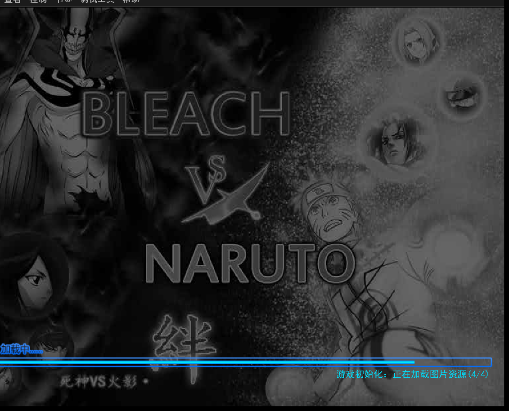
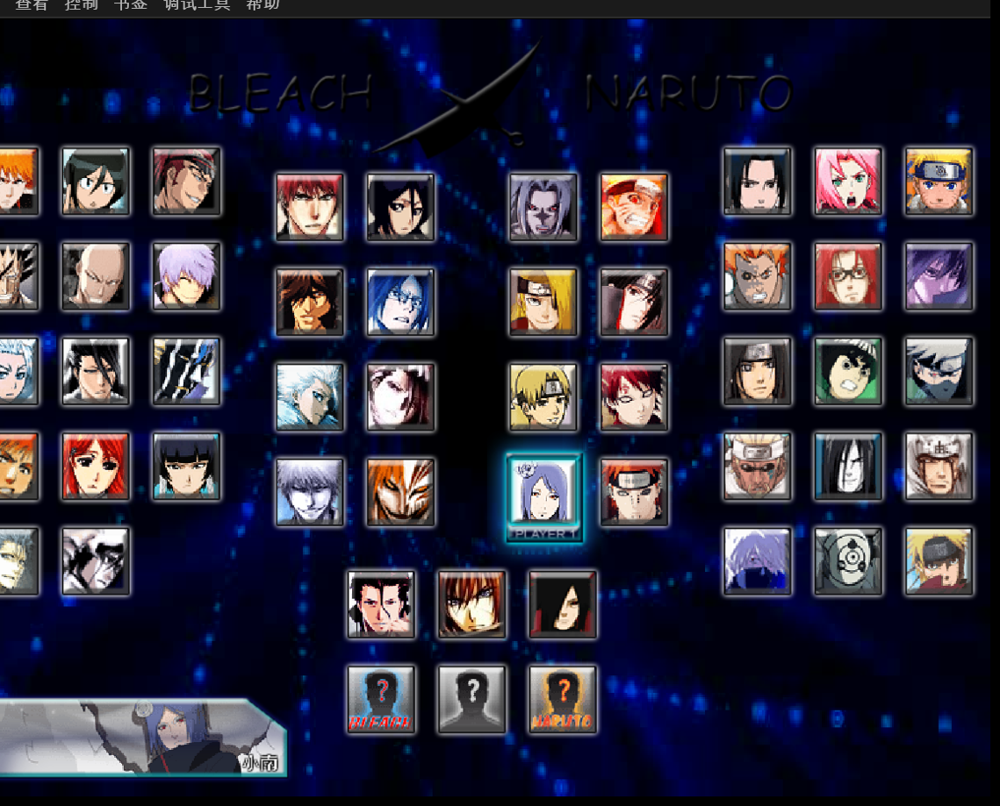
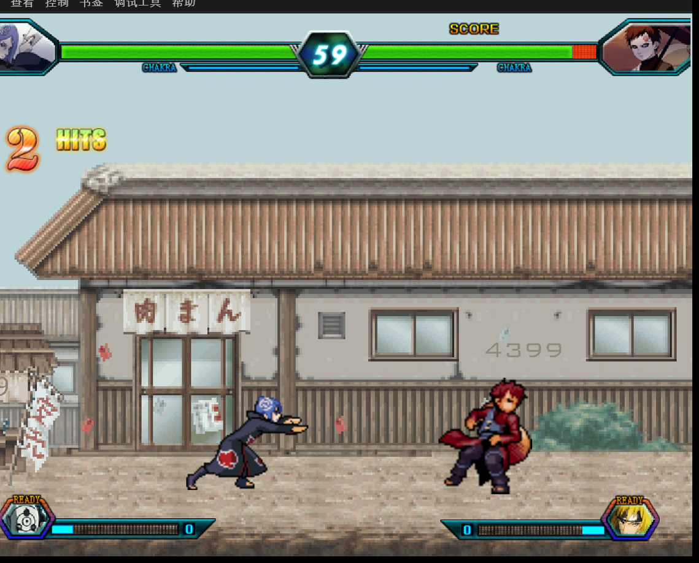

# 死神VS火影 3.3（Bleach vs Naruto）· 4399 Flash 拆解完整记录

从一个 4399 小游戏页面到**可离线运行的原版本体**，全流程记录。

<p align="center">
  
</p>

| | |
|---|---|
| **页面** | `4399.com/flash/205551_4.htm` |
| **游戏** | 死神VS火影 3.3 |
| **原始 SWF** | 65.87 MB · CWS · Flash v14 · 800×600 · 30fps |
| **真本体** | 66.21 MB · FWS · 原生 AS3 |
| **资源** | 407 个文件 · 62.95 MB |
| **角色** | 41 个 SWF / 59 个可选（形态差异） |
| **验证** | ✅ 已实测打到战斗 |

---

## 目录

- [核心发现](#核心发现)
- [三层结构](#三层结构)
- [第 1 步：找资源域名](#第-1-步找资源域名)
- [第 2 步：解外壳](#第-2-步解外壳)
- [第 3 步：取本体的关键](#第-3-步取本体的关键)
- [第 4 步：解资源包](#第-4-步解资源包)
- [第 5 步：运行](#第-5-步运行)
- [陷阱：加载器自检](#陷阱加载器自检)
- [陷阱：大量无效调试方向](#陷阱大量无效调试方向)
- [游戏内容](#游戏内容)
- [与急速变色龙的对比](#与急速变色龙的对比)
- [工具](#工具)
- [完整脚本](#完整脚本)
- [声明](#声明)

---

## 核心发现

**4399 页面站从不托管 SWF。** 真实资源在独立域名：

```
www.4399.com                     页面站
flashs1.4399.com/4399swf/        资源站
```

看到 404 不要急着判定「游戏下架」——先去 `server8.js` 找 `webServer`。

---

## 三层结构

```
1_原始下载.swf           65.87 MB   CWS · v14 · 800×600 · 30fps
 └─ zlib 解压           66.28 MB   仅 17 个 tag
     └─ DefineBinaryData chid=3      69.4 MB   FWS（未压缩）
         └─ 本体           66.21 MB   38 个 tag
             ├─ DoABC × 4              419 KB   脚本
             ├─ DefineBinaryData × 9   68.4 MB  资源
             │   └─ chid=222           ZIP
             │       └─ 407 个文件      assets/fighter/*.swf …
             ├─ DefineSound × 8        195 KB
             └─ DefineBitsJPEG2 × 3    458 KB
```

外层 17 个 tag 的构成：

```
chid=1         278 B    XML 配置（prefor_System4399Manager）
chid=2      10,043 B    GIF 加载动画（内嵌小 SWF）
chid=3      69.4 MB     游戏本体
```

---

## 第 1 步：找资源域名

```python
import re, urllib.request

PAGE = 'https://www.4399.com/flash/205551_4.htm'
req = urllib.request.Request(PAGE, headers={'User-Agent': 'Mozilla/5.0'})
raw = urllib.request.urlopen(req).read()

# 页面是 GBK，必须按原始字节解码，否则中文全是问号
html = raw.decode('gbk', 'replace')

game_path = re.search(r"_strGamePath\s*=\s*\"([^\"]+)\"", html).group(1)
print(game_path)
# /upload_swf/ftp29/haibo/suwei/y2/main.swf

# 资源域名在独立的 js 里
js = urllib.request.urlopen(
    'https://www.4399.com/js/server8.js', timeout=20).read().decode('gbk', 'replace')
server = re.search(r'webServer\s*=\s*["\']([^"\']+)', js).group(1)
print(server)
# //flashs1.4399.com/4399swf
```

拼起来下载：

```
https://flashs1.4399.com/4399swf/upload_swf/ftp29/haibo/suwei/y2/main.swf
```

> **注意**：页面用 GBK 编码。直接 `Invoke-WebRequest` 拿 `.Content` 会被错误解码成问号，要取原始字节再按 GBK 解。

---

## 第 2 步：解外壳

```python
import zlib, struct

d = open('1_原始下载.swf', 'rb').read()
assert d[:3] == b'CWS'

raw = zlib.decompress(d[8:])
shell = b'FWS' + bytes([d[3]]) + struct.pack('<I', len(raw) + 8) + raw
open('2_壳解压.swf', 'wb').write(shell)
```

`CWS` = zlib 压缩，`FWS` = 未压缩。解完后 tag 只有 17 个，非常干净。

---

## 第 3 步：取本体的关键

壳的 ActionScript 直接指明了载荷的 CharacterId：

```actionscript
[Embed(source="/_assets/3_L4399Main_gamefile.bin", mimeType="application/octet-stream")]
public class L4399Main_gamefile extends ByteArrayAsset { }
```

**`3_` 就是 chid。**

遍历 tag 找 `DefineBinaryData`（code=87）：

```python
def iter_tags(data, off):
    while off < len(data) - 1:
        hdr = struct.unpack('<H', data[off:off+2])[0]
        code, length = hdr >> 6, hdr & 0x3F
        body = off + 2
        if length == 0x3F:                        # 长格式
            length = struct.unpack('<I', data[off+2:off+6])[0]
            body = off + 6
        yield code, body, length
        if code == 0:
            return
        off = body + length
```

`DefineBinaryData` 结构：

```
CharacterId   u16
Reserved      u32
Data          ...      ← 载荷
```

```python
for code, body, length in iter_tags(shell, tags_start):
    if code != 87:
        continue
    chid = struct.unpack('<H', shell[body:body+2])[0]
    if chid == 3:
        payload = shell[body+6 : body+length]     # 69,431,196 bytes
        open('3_本体.swf', 'wb').write(payload)
```

### 这里有个容易踩的分支

**本载荷是 `FWS`（未压缩），不需要解压。**

上次拆急速变色龙时载荷是 `CWS`，要再 `zlib.decompress` 一次。这里直接用。

判断方法：

```python
head = payload[:3]
if head == b'FWS':
    pass                                  # 已是完整 SWF
elif head == b'CWS':
    payload = zlib.decompress(payload[8:])  # 还要解一次
```

---

## 第 4 步：解资源包

本体里的 `DefineBinaryData chid=222` 是个 ZIP：

```python
import zipfile
zipfile.ZipFile('chid_222.bin').extractall('assets_out')
```

407 个条目，62.95 MB：

| 目录 | 内容 | 数量 |
|---|---|---|
| `assets/fighter/` | 角色 SWF | 41 |
| `assets/fighter/fz/` | 辅助资源 | 35 |
| `assets/face/` | 头像（普通/大/血条/胜利） | 257 |
| `assets/map/` | 场景 SWF + 预览 PNG | 15 |
| `assets/bgm/` | 背景音乐 | 21 |
| `assets/config/` | XML 数据表 | 7 |
| `assets/font/` | 字体 | 2 |
| `assets/sounds/` | 音效 | 4 |

另外 8 个 `DefineBinaryData`（chid 225–2215）是字符资源模块，各 0.2–0.6 MB，本体自己会加载，不用单独处理。

---

## 第 5 步：运行

```
ruffle.exe 3_本体.swf
```

**必须用桌面版 Ruffle。** 浏览器版会卡在平台自检（见下节）。

实测三个阶段：

| 阶段 | 画面 |
|---|---|
| 启动 | 「BLEACH VS NARUTO 绊」标题、蓝染/一护/鸣人立绘、进度条 4/4 |
| 选人 | 59 个角色，死神侧 + 火影侧 + 中间特殊位，含「?」隐藏角色 |
| 选场景 | 15 个地图轮播，默认「随机场景」 |
| 战斗 | 小南 vs 我爱罗，血条 / 查克拉槽 / SCORE / 连击计数 |

<p align="center">
  
  
</p>

---

## 陷阱：加载器自检

### 症状

直接跑外层 `2_壳解压.swf`：

```
游戏运行出现问题
· 不允许加壳运行
```

### 误判

第一反应是「又遇到反盗版机制」，于是花了很多时间去找绕过方案：

- 搜 `getLabel("shell")` 定位到 `serviceHold.isReady` 判定
- 追到 `http://www.greenhd.net/ns/greenload`，发现该域名已 404
- 写了 stub 服务器想模拟远程配置
- 试图改 hosts 把域名指向本地

**全都是错的方向。**

### 真相

`L4399Main` 是 4399 的平台加载器。它启动时检查**自己是不是被当作顶层 SWF 加载**——如果是，说明有人跳过了 4399 的页面直接开壳，就拒绝运行。

**但这个检查在跑本体时根本不触发。** 本体是 `L4399Main_gamefile` 里 `loadBytes` 出来的内容，本来就是被加载的，检查自然通过。

所以正确做法只有一个：

```
❌ ruffle.exe 2_壳解压.swf
✅ ruffle.exe 3_本体.swf
```

### 教训

「不允许加壳运行」这句中文有歧义——它字面意思是「我不允许被加壳」，实际是「我不允许当壳跑」。

**先换一个文件试，再去改代码。** 这次如果第一时间跑本体，能省掉整个 `greenhd.net` 方向的探索。

---

## 陷阱：大量无效调试方向

记录一下走过的弯路，都是「看起来很有道理但不解决问题」：

| 尝试 | 结果 |
|---|---|
| 搜 ABC 常量池定位 `isReady` | 在 frame1 ABC 里找不到，因为它根本不在那 |
| 手写 ABC 解析器读常量池 | `int` 初始值用变长 s32、`uint` 用 u30，编码不统一，连续撞错位 |
| 改 `xml` 里的 `gameid` | 与本问题无关 |
| 起 `greenload_stub.py` 模拟远程配置 | 域名 `greenhd.net` 已死，但游戏跑本体时压根不请求它 |
| 改 hosts 指向本地 | 需要管理员权限，且方向错误 |
| 用 `http://127.0.0.1` 提供页面域名 | `Security.pageDomain` 有了，但白名单不含 localhost，仍然失败 |

### ABC 解析的三个真实坑（如果以后真的要改字节码）

**1. SWF 可能有多块 ABC**

这个包有 4 个 `DoABC`，名字都叫 `merged`，主逻辑不在你猜的那个里。

**2. ABC 头 minor 在前**

```python
minor = struct.unpack('<H', abc[0:2])[0]   # 16
major = struct.unpack('<H', abc[2:4])[0]   # 46
```

**3. 常量池编码不统一**

```
int 初始值    变长 s32（5 位符号扩展）
uint 初始值   u30
double        定长 8 字节
```

混用会导致后续全部错位。我在这上面耗掉的尝试次数远超预期。

---

## 游戏内容

### 角色系统

`assets/config/fighter.xml` 声明 **59 个可选角色**，但只有 41 个 SWF 文件——**靠 `startFrame` 区分形态**：

```xml
<fighter id="ichigo" name="黑崎·一护" comic_type="0">
    <file url="assets/fighter/ichigo.swf" startFrame="1" />
    <face url="assets/face/ichigo.png" big_url="assets/face/ichigo_b.png"
          bar_url="assets/face/ichigo_m.png" win_url="assets/face/ichigo_w.png" />
    <says>
        <say_item>光是战斗根本没有意思 只是活下去也没有意义。</say_item>
        <say_item>我也不知道为什么，总之很爽就是了！</say_item>
        <say_item>正因为我们看不见，那才可怕。</say_item>
    </says>
    <bgm url="assets/bgm/ichigo.mp3" rate="100" />
</fighter>

<fighter id="ichigo_wanjie" name="黑崎·一护 卍解" comic_type="0">
    <file url="assets/fighter/ichigo.swf" startFrame="2" />   ← 同一个文件，不同帧
    ...
</fighter>
```

一护 7 种形态：

```
ichigo               黑崎·一护
ichigo_wanjie        卍解
ichigo_xuhua_half    半虚
ichigo_xuhua         虚化
ichigo_zero          零段
ichigo_neixu         内虚
ichigo_neixu_wanjie  内虚卍解
```

鸣人 5 种（`naruto` / `_yw` / `_sw` / `_xianren` / `_gold`），佐助同理。

**每个角色独立配置台词和 BGM**，这是数据驱动的设计。

### 场景系统

`assets/config/map.xml` —— 15 个场景，各绑独立 SWF + 预览图 + BGM：

```xml
<map id="liuhunjie" name="流魂街">
    <file url="assets/map/liuhunjie.swf" />
    
    <bgm url="assets/bgm/village.mp3"/>
</map>
```

完整列表见 [`config/map.xml`](config/map.xml)，角色完整配置见 [`config/fighter.xml`](config/fighter.xml)。

---

## 与急速变色龙的对比

同样是 4399 的壳，结构差异不小：

| | 急速变色龙 | 死神VS火影 |
|---|---|---|
| 壳大小 | 10.39 MB | 65.87 MB |
| 壳 tag 数 | — | 17 |
| 载荷格式 | **CWS（压缩）** | **FWS（未压缩）** |
| 载荷大小 | 10.28 MB | 69.4 MB |
| 本体引擎 | Unity → Flash | **原生 AS3** |
| 本体 tag 数 | — | 38 |
| 资源组织 | 36 个 Unity 序列化容器 | **407 个散装文件（ZIP）** |
| 脚本量 | 1,324 个 `.as` | 40 个 `.as`（壳层） |
| 角色 | 1 个（多形态） | 59 个 |

**共同点**：都靠 `L4399Main_gamefile` 这个 `[Embed]` 常量定位载荷，都有 `Decryption.as`（但都没真正加密）。

**差异的原因**：急速变色龙是 Unity 导出（重引擎、重运行时），死神VS火影是手写 AS3（轻代码、重资源）。

---

## 工具

| 工具 | 用途 | 获取 |
|---|---|---|
| **Ruffle 桌面版** | 运行（浏览器版过不了自检） | [ruffle-rs/ruffle](https://github.com/ruffle-rs/ruffle/releases) → `*-windows-x86_64.zip` |
| **FFDec** | 反编译壳层 40 个类 | [jindrapetrik/jpexs-decompiler](https://github.com/jindrapetrik/jpexs-decompiler) |
| **Python 3.10+** | 解包脚本，仅标准库 | — |

不需要 Flash 插件，Ruffle 自带运行时。

> 本仓库不打包 Ruffle 与 FFDec，请从官方发布页下载。

---

## 完整脚本

一次跑完整个流程：

```python
#!/usr/bin/env python3
"""4399 Flash 三层解包器 — 死神VS火影适用"""
import re, struct, sys, urllib.request, zipfile, zlib

PAGE = 'https://www.4399.com/flash/205551_4.htm'
UA = {'User-Agent': 'Mozilla/5.0 (Windows NT 10.0; Win64; x64) Chrome/131.0'}


def fetch(url):
    return urllib.request.urlopen(urllib.request.Request(url, headers=UA), timeout=60).read()


def find_asset_url():
    html = fetch(PAGE).decode('gbk', 'replace')
    path = re.search(r"_strGamePath\s*=\s*\"([^\"]+)\"", html).group(1)
    js = fetch('https://www.4399.com/js/server8.js').decode('gbk', 'replace')
    host = re.search(r'webServer\s*=\s*["\']([^"\']+)', js).group(1)
    return 'https:' + host + path


def unwrap(data):
    if data[:3] == b'FWS':
        return data
    if data[:3] == b'CWS':
        raw = zlib.decompress(data[8:])
        return b'FWS' + bytes([data[3]]) + struct.pack('<I', len(raw) + 8) + raw
    raise ValueError('not a SWF')


def tags(fws):
    p = 8
    nb = fws[p] >> 3
    p += ((5 + nb * 4) + 7) // 8
    p += 4                                  # framerate + framecount
    while p < len(fws) - 1:
        hdr = struct.unpack('<H', fws[p:p+2])[0]
        code, length = hdr >> 6, hdr & 0x3F
        body = p + 2
        if length == 0x3F:
            length = struct.unpack('<I', fws[p+2:p+6])[0]
            body = p + 6
        yield code, body, length
        if code == 0:
            return
        p = body + length


def binary_data(fws, want):
    for code, body, length in tags(fws):
        if code != 87:
            continue
        chid = struct.unpack('<H', fws[body:body+2])[0]
        print('  DefineBinaryData chid=%-5d len=%d' % (chid, length - 6))
        if chid == want:
            return fws[body+6 : body+length]
    return None


def main():
    url = find_asset_url()
    print('[1] asset url: %s' % url)
    shell = unwrap(fetch(url))
    print('[2] shell: %d bytes' % len(shell))

    payload = binary_data(shell, want=3)
    if payload is None:
        print('[x] chid=3 not found')
        return 1
    body = unwrap(payload)
    open('3_本体.swf', 'wb').write(body)
    print('[3] body: %d bytes' % len(body))

    outer = binary_data(body, want=222)
    if outer and outer[:4] == b'PK\x03\x04':
        open('222.zip', 'wb').write(outer)
        with zipfile.ZipFile('222.zip') as z:
            z.extractall('assets_out')
            print('[4] assets: %d files' % len(z.infolist()))

    print('\ndone. run:  ruffle.exe 3_本体.swf')
    return 0


if __name__ == '__main__':
    sys.exit(main())
```

---

## 声明

**游戏著作权归原作者及 4399 所有。** 死神VS火影由 5Dplay 制作，4399 发行。

本仓库只含**技术笔记、配置表副本和截图**，不包含游戏本体（65 MB+ 的 SWF）或角色资源。请自行按本文档流程从源站获取，仅用于个人研究与保存。

请勿商用或二次分发游戏文件。
